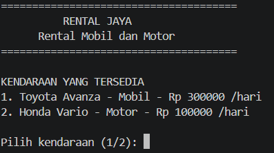
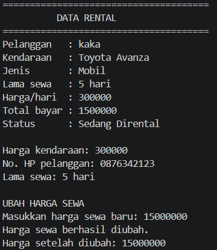
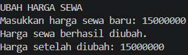
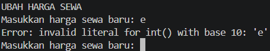

# Sistem Pengelolaan Rental Mobil dan Motor untuk Pelanggan

Program Python berbasis OOP untuk mengelola kendaraan, pelanggan, dan transaksi rental.

---

## 1. Deskripsi Program

Program ini merupakan **Sistem Pengelolaan Rental Mobil dan Motor** menggunakan Python dengan konsep OOP. Program digunakan untuk memilih kendaraan, memasukkan data pelanggan, menentukan lama sewa, dan menghitung biaya rental.

## 2. Class yang Digunakan

Program memiliki 3 class utama:

* **Kendaraan** : menyimpan data kendaraan dan harga sewa.
* **Pelanggan** : menyimpan data pelanggan.
* **Rental** : mengatur transaksi dan menghitung biaya sewa.

## 3. Konsep OOP

Program menerapkan:

* **Class & Object** : membuat class dan objek kendaraan, pelanggan, dan rental.
* **Atribut & Method** : setiap class memiliki data dan fungsi.
* **Encapsulation** : menggunakan atribut private seperti `__harga_sewa`, `__no_hp`, dan `__lama_sewa`.
* **Property** : digunakan sebagai getter dan setter untuk mengakses atribut private.

## 4. Jenis Method

Program menggunakan:

* **Instance method** : `info_kendaraan()`, `info_pelanggan()`, dan `hitung_total()`.
* **Class method** : `ubah_tarif_denda()` dan `ubah_lama_maksimal()`.
* **Static method** : `cek_jenis()` dan `cek_nama()`.

## 5. Validasi

Program melakukan validasi pada:

* Pilihan kendaraan.
* Nomor HP pelanggan.
* Lama sewa.
* Harga sewa.
* Data yang dimasukkan melalui setter.

## 6. Bukti Screenshot

### Screenshot 1 – Pemilihan Kendaraan dan Data Pelanggan

### Screenshot 2 – Informasi Rental

### Screenshot 3 – Perubahan Harga dan Kebijakan Rental

### Screenshot 4 – Validasi Data Tidak Valid

