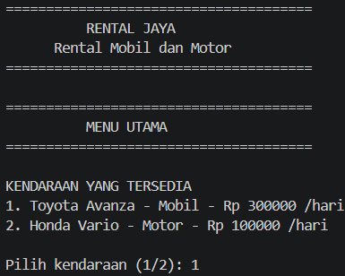
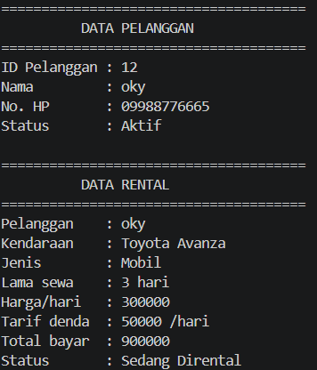
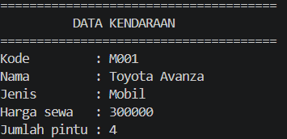
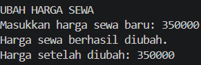
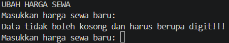
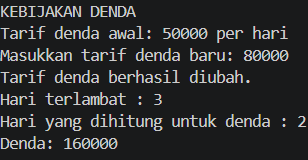
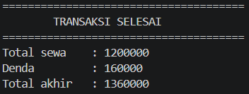

# Sistem Pengelolaan Rental Mobil dan Motor untuk Pelanggan

Program Python berbasis OOP yang digunakan untuk mengelola kendaraan, data pelanggan, transaksi rental, dan denda keterlambatan.

## 1. Struktur Class

Program memiliki beberapa class yang saling berhubungan:

* **Kendaraan** → superclass yang menyimpan data umum kendaraan.
* **Mobil** → subclass dari Kendaraan dengan atribut jumlah pintu.
* **Motor** → subclass dari Kendaraan dengan atribut kapasitas CC.
* **Pelanggan** → menyimpan data pelanggan rental.
* **Rental** → mengatur transaksi penyewaan.
* **DetailRental** → menyimpan detail lama sewa.

Struktur inheritance:

          Kendaraan
          /       \
      Mobil       Motor

## 2. Konsep OOP

Program menerapkan beberapa konsep OOP:

* **Class & Object** → membuat objek kendaraan, pelanggan, dan rental.
* **Atribut & Method** → setiap class memiliki atribut dan method.
* **Encapsulation** → menggunakan atribut private seperti `__harga_sewa`, `__no_hp`, dan `__lama_sewa`.
* **Property** → digunakan untuk getter dan setter.
* **Inheritance** → `Mobil` dan `Motor` mewarisi class `Kendaraan`.
* **Method Overriding** → `info_kendaraan()` dibuat ulang pada class `Mobil` dan `Motor`.

## 3. Relasi UML

Program menggunakan tiga jenis relasi:

* **Asosiasi** → `Rental` berhubungan dengan `Kendaraan`.
* **Agregasi** → `Rental` menggunakan objek `Pelanggan`.
* **Komposisi** → `Rental` membuat dan memiliki `DetailRental`.

## 4. Tingkat Akses Atribut

* **Public** → contoh `kode`, `jenis`, dan `id_pelanggan`.
* **Protected** → `_nama` pada class `Kendaraan`, yang dapat digunakan oleh subclass.
* **Private** → `__harga_sewa`, `__no_hp`, dan `__lama_sewa`.

## 5. Jenis Method

Program menggunakan:

* **Instance method** → `info_kendaraan()`, `info_pelanggan()`, `hitung_total()`.
* **Class method** → `ubah_tarif_denda()`, `ubah_lama_maksimal()`.
* **Static method** → `cek_jenis()`, `cek_nama()`, `hitung_denda()`.

## 6. Validasi dan Denda

Program melakukan validasi terhadap data yang dimasukkan pengguna, seperti ID pelanggan, nomor HP, lama sewa, dan harga sewa.

Untuk keterlambatan pengembalian:

* Terlambat **0–1 hari** → tidak dikenakan denda.
* Terlambat **lebih dari 1 hari** → denda dihitung berdasarkan jumlah hari setelah batas 1 hari tersebut.
* Tarif denda dapat diubah melalui program.

## 7. Bukti Screenshot

### Screenshot 1 – Menu dan Pemilihan Kendaraan

### Screenshot 2 – Data Pelanggan dan Rental

### Screenshot 3 – Inheritance

### Screenshot 4 – Setter dan Validasi

### Screenshot 5 – Denda Keterlambatan

### Screenshot 6 – Jumlah Data

Kemudian ikuti input yang ditampilkan sampai transaksi selesai. Setelah selesai, tekan **Enter** untuk kembali ke menu awal.
