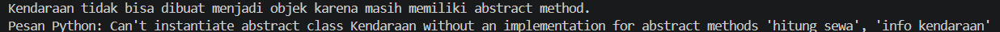
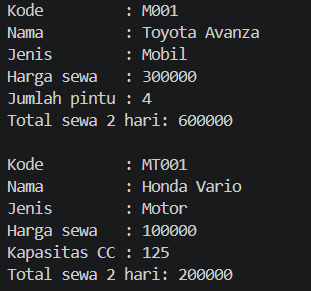
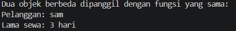
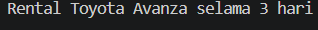
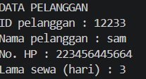
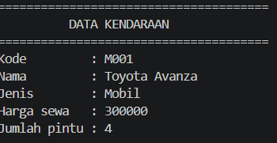
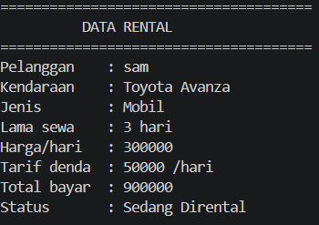
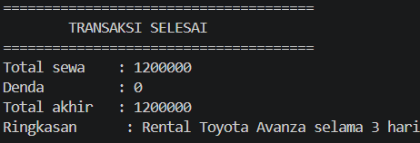

# Sistem Pengelolaan Rental Mobil dan Motor untuk Pelanggan

## 1. Deskripsi Program

Rental Jaya merupakan program berbasis Python yang digunakan untuk mengelola penyewaan kendaraan berupa mobil dan motor. Program ini menyediakan fitur pemilihan kendaraan, pengisian data pelanggan, perhitungan biaya sewa, pengelolaan harga sewa, serta perhitungan denda keterlambatan.

Program dibuat menggunakan konsep **Object-Oriented Programming (OOP)** untuk menerapkan class, object, inheritance, abstraction, polymorphism, encapsulation, duck typing, dan operator overloading.

## 2. Fitur Program

- Menampilkan kendaraan yang tersedia, yaitu Toyota Avanza dan Honda Vario.
- Memasukkan dan menampilkan data pelanggan.
- Menentukan lama penyewaan kendaraan.
- Menghitung total biaya penyewaan.
- Mengubah harga sewa dan tarif denda.
- Memvalidasi data pelanggan dan lama penyewaan.
- Menghitung denda keterlambatan pengembalian.
- Menampilkan ringkasan transaksi penyewaan.

## 3. Class Diagram

Diagram tersebut menggambarkan struktur class, atribut, method, dan hubungan antarkelas pada program Rental Jaya.

### Penjelasan Hubungan Antarkelas

1. **Inheritance (Pewarisan)**  
   Class `Mobil` dan `Motor` mewarisi class `Kendaraan`. Kedua class tersebut memiliki atribut dan perilaku umum dari `Kendaraan`, serta mengimplementasikan method abstrak yang diwajibkan.

2. **Association (Asosiasi)**  
   Class `Rental` berhubungan dengan class `Kendaraan` karena setiap transaksi penyewaan menggunakan kendaraan yang dipilih pelanggan.

3. **Aggregation (Agregasi)**  
   Class `Rental` menggunakan objek `Pelanggan` yang dibuat secara terpisah. Objek pelanggan dapat tetap ada meskipun tidak sedang digunakan dalam transaksi tertentu.

4. **Composition (Komposisi)**  
   Class `Rental` membuat objek `DetailRental` di dalam konstruktor. Objek tersebut digunakan untuk menyimpan informasi lama penyewaan pada transaksi.

## 4. Penerapan Konsep OOP

### 4.1 Class dan Object

Program menggunakan enam class utama, yaitu:

- `Kendaraan`: class dasar untuk kendaraan.
- `Mobil`: class kendaraan jenis mobil.
- `Motor`: class kendaraan jenis motor.
- `Pelanggan`: menyimpan informasi pelanggan.
- `DetailRental`: menyimpan informasi lama penyewaan.
- `Rental`: mengelola transaksi penyewaan.

Object dibuat berdasarkan class tersebut untuk menjalankan proses penyewaan kendaraan.

### 4.2 Abstraction (Abstraksi)

Class `Kendaraan` menggunakan `ABC` dan memiliki dua abstract method:

- `info_kendaraan()`
- `hitung_sewa(lama_sewa)`

Class `Mobil` dan `Motor` mengimplementasikan kedua method tersebut. Class `Kendaraan` juga memiliki method biasa `info_umum()`.

Program mencoba membuat object langsung dari class `Kendaraan`. Percobaan tersebut menghasilkan `TypeError` karena abstract method belum diimplementasikan.

### 4.3 Inheritance (Pewarisan)

Class `Mobil` dan `Motor` mewarisi class `Kendaraan`. Keduanya menggunakan `super().__init__(...)` untuk menjalankan konstruktor class induk dan memiliki atribut khusus masing-masing, yaitu `jumlah_pintu` untuk mobil dan `kapasitas_cc` untuk motor.

### 4.4 Polymorphism (Polimorfisme)

Polimorfisme melalui pewarisan diterapkan ketika program memanggil method `info_kendaraan()` dan `hitung_sewa()` pada object `Mobil` dan `Motor` melalui satu perulangan. Method yang sama menghasilkan informasi dan perhitungan sesuai jenis kendaraan.

### 4.5 Duck Typing

Duck typing diterapkan melalui fungsi `tampilkan_ringkasan(objek)`. Fungsi tersebut dapat menerima object dari class `Pelanggan` dan `DetailRental` karena keduanya memiliki method `ringkasan()`, meskipun kedua class tidak memiliki hubungan pewarisan.

### 4.6 Operator Overloading

Class `Rental` memiliki special method `__str__()`. Method ini mengatur tampilan object rental ketika dipanggil menggunakan `print(rental)`, sehingga informasi transaksi dapat ditampilkan dalam bentuk teks yang mudah dibaca.

### 4.7 Encapsulation (Enkapsulasi)

Enkapsulasi diterapkan melalui atribut private, seperti `__harga_sewa` pada class `Kendaraan` dan `__no_hp` pada class `Pelanggan`. Property digunakan untuk mengakses dan mengubah nilai atribut tersebut dengan validasi.

## 5. Scrennshoot Pengujian Program

1. **Abstract class:** 
    
2. **Polimorfisme:** 
    
3. **Duck typing:** 
    
4. **Operator overloading:** 
    
5. **Transaksi rental:** 
    
    
    
    
